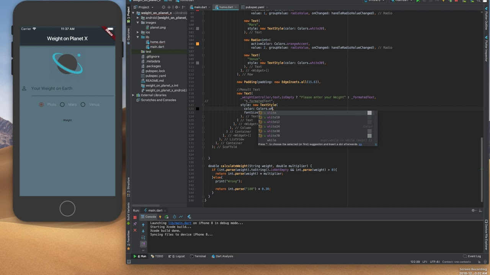

<h1 align="center"> Sobre Mi 👋</h1>

<h1 align="center">
  
</h1>

Mi nombre es Brayan Martinez, soy desarrollador Full Stack, me dedico al desarrollo de soluciones de software 
a medida, para clientes nacionales  e internacionales, usando un conjunto de tecnologías específicas, puedo 
lograr que su empresa pueda funcionar con mayor eficiencia, con la automatización de procesos de negocio, a 
través de solucione de software a medida.

# Tecnologia 🔵

### Soluciones con Dart 🐦

- **Desarrollo con Flutter:** El framework [Flutter](https://flutter.dev/) ofrece la ventaja de que con la misma 
  base de código se puede crear **soluciones multiplataforma (Web, Mobil, Desktop)** de manera limpia, segura y con un 
  excelente acabado estético, ideal para ahorrar costo, crear un producto atractivo para el usuario final y tener un 
  mayor alcance de usuarios en distintas plataformas. Flutter es ideal para pequeños negocios como: restaurantes, 
  neo-bancos, empresas de movilidad, empresas de redes sociales, entre otro tipo de empresas, Veamos Algunos ejemplos:
  - [Dsjtra example](https://github.com/Ing-Brayan-Martinez/flutter_dijkstra_example)
  - [AraGis example](https://github.com/Ing-Brayan-Martinez/osm_flutter_demo)
  - [Gemini example](https://github.com/Ing-Brayan-Martinez/dart_gemini_example)
  - [Flutter example](https://github.com/Ing-Brayan-Martinez/dart_flutter_example.git)

### Soluciones Web 🐝

- **Desarrollo con Vue:** Vue es un framework muy usado, puede encontra informacion aqui [Vue](https://vuejs.org/), una de 
  las ventaja de Vue es que soporta [Vite](https://vite.dev/) y sobretodo el soporte de unit testing usando[Vitest](https://vitest.dev/guide/). 
  Otro aspecto importante es usar alguna librería de componentes con Vue tenemos [Vuetify](https://vuetifyjs.com/en/) tambien 
  contamos con un excelente gestor de estado llamado [Pinia](https://pinia.vuejs.org/) como puede observar Vue cuenta con un buen 
  ecosistema ideal para crear aplicaciones web grandes como: ERPs, banca en linea, tiendas online, plataforma educativas, entro tipo
  de soluciones tecnologicas.

### Soluciones Java 🐍

- **Desarrollo con Spring Boot:** Es una tecnologia consolidada en el mercado para desarrollo back end,
  [Spring Boot](https://spring.io/projects/spring-boot) es un framework para desarrollar aplicaciones
  back end de manera rapida y eficiente, con un enfoque en la simplificacion de la configuracion y el desarrollo.

  Veamos algunos ejemplos en Java:
  - [Spring Beans](https://github.com/Ing-Brayan-Martinez/Java-SpringBoot-BeansFactory)
  - [Spring Boot Jpa](https://github.com/Ing-Brayan-Martinez/Java-SpringBoot-JPA)
  - [Spring Boot WebFlux](https://github.com/Ing-Brayan-Martinez/Java-SpringBoot-WebFlux)
  
### Integraciones y API ☁️

  - **Integración con la Gemini API:** A partir del **2022 el auge de la inteligencia  artificial** se ha echo muy importante 
    y es necesario brindar soluciones en este area, para eso me apoyo con el [AI Studio](https://aistudio.google.com/app/prompts/new_chat) 
    para usa el modelo [Gemini](https://gemini.google.com/app) proveido por Google usando la libreria 
    [google_generative_ai ](https://ai.google.dev/gemini-api/docs/get-started?hl=es-419) la cual es compatible con Flutter y Android para 
    implementar modelos IA desde la nube usando la API de Gemini consultar la [documentacion](https://ai.google.dev/).

  - **Integración con el SDK de ArcGIS:** Se usa para la implementacion de mapas, georeferenciados, en diferentes tipo de aplicaciones, para 
    esto se usa el SDK [ArcGIS](https://developers.arcgis.com/) para generar mapas de alta calidad.
  
# Tecnologia 🟣

### Soluciones con Rust 🦀

- **Desarrollo con Axum:** Es un framework backend echo en [Rust](https://rust-lang.org/) tecnologia consolidada en el mercado para desarrollo 
  de codigo de bajo nivel de alta eficiencia, esto es ideal para construir sistemas concurrentes y de mision critica, con 
  [Axum](https://docs-rs.translate.goog/axum/latest/axum/index.html?_x_tr_sl=en&_x_tr_tl=es&_x_tr_hl=es&_x_tr_pto=tc) puedes construir API Rest Full 
  similar a node.js de forma simple, estoy entrando en esto, es algo nuevo para mi

### Soluciones con PHP 🐘

- **Desarrollo con Laravel:** Es un framework php para crea aplicaciones MVC o API Rest Full facil y practico aun usado en la industria, con Laravel
  se puede crear aplicaciones web de forma rapida, para mas informacion ver su web oficial [Laravel](https://laravel.com/) , estoy entrando en esto, es
  algo nuevo para mi